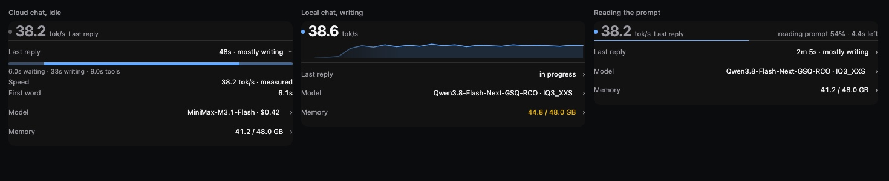

# Gauge

A `Gauge` section for OpenChamber's Work Status panel: how fast your chat is
being delivered, what the engine is doing right now, and — on a Mac — what the
machine is using.

Gauge reads; it never sends inference, starts a render or changes a setting.

## What it shows



A headline, the last 30 seconds of speed, and three lines. Each line shows the
one value worth a glance; a tap opens what is behind it, one line at a time.

| | |
|---|---|
| headline | the running turn's average speed, greyed and labelled `Last reply` when nothing is arriving. The state sits on the right: `running tool`, `waiting for permission`, the prompt a local llama.cpp chat is reading (`reading prompt 40% · 6.0s left`), `compacting` while the chat rewrites its own history, or the ComfyUI render running now (`render 8 / 20 · 30s · 1 queued`). A watched chat with nothing to report says `no reply yet`, and the dot goes quiet when the chat has nothing to say |
| curve | the last 30 s of generation rate, one point per 1.25 s, dimming out on the left. While there is nothing to draw the band closes up |
| divider | the line under the curve fills while a prompt is read or a render runs |
| `Last reply` | how long the reply took and what most of that was (`48s · mostly writing`). Behind it: the receipt, a bar cut into `reading`, `waiting`, `writing` and `tools` that add up to the whole reply; the speed (`measured` when the provider reported token counts, `estimated` otherwise); and the time to the first word |
| `Model` | the model the chat is on and what the chat has cost (`MiniMax-M3.1-Flash · $0.42`), or `Qwen3.8-Flash-Next-GSQ-RCO · IQ3_XXS` when the local engine holds it. Behind it: the cost, the cache hit rate of the last settled step and of the whole conversation, the model the local engine holds, and the full identifier |
| `Memory` | the Mac's memory in use and the total; amber at a kernel warning, red at a critical level. Behind it: the meter, the swap in use and the pressure level. A machine that is not a Mac gets no Memory line at all |

A reading that is missing is a dash. A job never adds a line: it is said in the
headline. A wording too long for the headline — a notice, or a state that does
not fit beside the number — is read in full in the curve's spot. A turn longer
than a minute is read as minutes (`2m 5s`). Nothing needs a mouse; the hover
text is a duplicate of what a tap shows. Motion (the number gliding, a line
sliding open, the reply bar filling in once) is switched off when the system
asks for reduced motion.

## What it needs

- OpenChamber 2.7.0 or newer, with Gauge approved in **Settings → Extensions**:
  the approval is what lets Gauge's service read this app's sessions, and it is
  what hands the service the address to read them from
- OpenCode 2.0.25 or newer for the prompt reading; other versions keep the rest
- Node.js 22 or newer
- a local llama.cpp engine for the prompt reading: llama.cpp's own server,
  llama-swap in front of one, or Splash in front of either
- macOS for the memory row; ComfyUI (any of 127.0.0.1:18188, :8188 or :8000) for
  the render row

## How it measures

**Speed** is measured from OpenChamber's own event stream: the characters of a
reply as they arrive, divided by the span they cover. There is no tokenizer, so
the live number starts at `characters ÷ 4` and is corrected toward the
provider's own token count as each step settles (`measured` once it has).
Tool-call JSON past 200 characters and any pause longer than a second are left
out of the average.

**The prompt reading** comes from the engine's own `return_progress` frames:
llama.cpp's server puts the prompt's progress on the stream when a request asks
for it, with `total`, `cache`, `processed` and `time_ms`. A small plugin
OpenChamber adds to its OpenCode adds `return_progress: true` to a streaming
request to an engine it recognizes, watches that same response for
`prompt_progress` frames until the reply starts, and writes the counters to
`~/.cache/gauge/prompt-progress`. The service reads that file. No prompt, reply,
header, key or raw session id is written: the session is a hash.

Which engines are asked is decided without guessing and without a credential. A
provider named for one (`splash`, `llama-swap`, `llama-server`, `llama.cpp`) is
asked at once. Any other provider on a loopback `/v1` is asked only after its own
`GET /props` answers with llama.cpp's server properties. An engine behind an API
key answers 401 and Gauge does not go looking for that key: what not asking costs
is the prompt line for that one provider, and nothing else. LM Studio and Ollama
are never asked — Ollama runs llama.cpp inside but answers with an API of its own,
which knows neither option. A probe runs behind the request, never inside it: a
chat is never made to wait for one, and while a probe is still running that
provider's requests leave exactly as OpenCode wrote them. A yes is kept for five
minutes; a no, or a probe that never answered, is re-asked after thirty seconds.

**The receipt** is the turn from its start to its end, without the time spent
waiting on you for a permission or an answer. `writing` is the span the speed
is measured over and `tools` is the time tools ran; `reading` is the engine's own
prefill time, known only for a local llama.cpp chat and only while a Work Status
panel was open to take the reading; `waiting` is what is left, the model before
its first word and between steps. A cloud reply has no `reading` slice: that time
is inside `waiting`.

**The cost** is the sum of what each step's event reported. A provider that
reports none, such as a local engine or a subscription, shows a dash.

**The render** is read from ComfyUI's own job list (`/api/jobs`). The step
counter appears when ComfyUI broadcasts its progress, which it does for a job
queued without a `client_id`.

**The model** is the one the chat is on. The status page tells the service which
model the chat has selected, and the step events name the model that actually
ran, so the row is right before the first step and after a model switch. The
local engine's own reading comes from Splash's own status (`/status`) and sits
behind the line: Splash's launcher writes a `serve-PORT.json` record for every
server it starts, so the service knows which port to ask and which process
should answer on it. A record outlives its server, so each one is checked
twice: the process must still be alive, and the server on that port must
report the same process and port. A server that is stopped, recovering, or that
has released its weights says so, and then that entry is a dash.
Nothing is started, stopped or loaded to read it. That reading is Splash's own:
an engine run without Splash leaves it a dash.

**The memory** is read from `vm_stat` and `sysctl`: the kernel's own pressure
level, never one inferred from occupancy, and Activity Monitor's "memory used"
(app memory + wired + compressed).

## Connection and local data

OpenChamber hands the service what it needs to read: the address of its own
OpenCode, and a token that names this extension. The service reads OpenCode's
event stream at that address with that token, and posts each watched chat's
reading back through the same channel — which is how an open section gets its
numbers without asking for them four times a second. A host that does not take
those posts leaves the page asking for them itself, and the section looks and
behaves the same. The service never reads OpenChamber's settings for a client
token or a UI password, never scans for a port to guess at, and sends nothing to
an address OpenChamber did not name. Redirects are not followed.

Gauge keeps its own numbers — bounded session IDs, model names, token counts,
cache totals and speed history — in a `state.json` inside the data folder
OpenChamber creates for this extension. That folder survives restarts and updates
and is deleted with the extension. Before 1.0 the file sat beside the service,
inside the installed package; a service that finds such a file reads it once and
removes it, so an existing install keeps its last turns and its learned
calibration. Nothing saved is the content of a prompt or a reply, and the
prompt-progress plugin's separate cache holds hashed identifiers rather than raw
session and model IDs.

The memory reading is two system commands the manifest names up front
(`/usr/bin/vm_stat` and `/usr/sbin/sysctl`), on macOS only. The service runs with
your user account's access; it is not sandboxed.

## Install

Open **Settings → Extensions**, paste this repository's URL into **Folder, ZIP,
or URL**, and choose **Add**:

```
https://github.com/mikebuckets171/openchamber-gauge
```

Approve Gauge when it asks: that approval is what lets the service read your
sessions, and what makes OpenChamber hand it the address to read them from. The
extension also asks once to add its plugin to OpenChamber's OpenCode, which is
how the prompt reading works; without it, everything else still shows. Approving
an earlier Gauge again keeps its numbers — 1.0 reads the file the earlier one
wrote and moves them where 1.0 keeps them. The built JavaScript files are in the
repository, so a Git install needs no dependency install and no build.

Then turn **Gauge** on in the chat's **Work Status** panel, under **Choose
sections**.

## Verify

```
npm test          # smoke, regressions, page smoke, cache and the OpenCode plugin
bun test service  # the parsers behind the readings, and the receipt's arithmetic
```

`node scripts/preview.mjs <file.html>` writes a scratch page to `<file.html>`
(a temporary file by default) that draws the section's own CSS around the
markup the page builds, for checking a layout change in a browser without
OpenChamber. It is a development aid: nothing in the shipped section uses it.

`node scripts/mount-preview.mjs` goes further: it copies the real built page
into frames of a fake host that answers the way OpenChamber's proxy does — idle,
writing, compacting, an empty chat, a refused service — so a headless browser
photographs what the shipped section really paints, including the parts only a
real host can trigger. Same development aid, same exemption.

## Credits and licence

Gauge's speed measurement, its curve, its calibration and its cache accounting
come from [Live TPS](https://github.com/wwwzzzxxx/openchamber-live-tps) by
wzx, MIT licensed, with changes: the floating panel is gone, and the Mac,
prompt and render readings are new. Gauge's prompt-progress plugin is ported
from [MLX Scope](https://github.com/mikebuckets171/mlx-scope-openchamber)'s
OpenCode helper, MIT licensed, with its chat-delivery observer removed.

Gauge is MIT licensed too. See [LICENSE](LICENSE).
